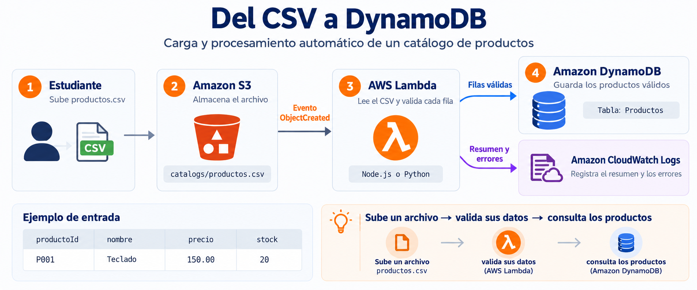

import Tabs from '@theme/Tabs';
import TabItem from '@theme/TabItem';

# Carga automática de datos con Amazon S3, AWS Lambda y Amazon DynamoDB

Una tienda recibe su catálogo de productos en CSV y necesita cargarlo en una base de datos **sin ingresar cada producto a mano**.

En este workshop construyes un flujo **event-driven**, todo **desde la consola de AWS**. Al subir el archivo a S3, Lambda lo procesa y deja los productos válidos en DynamoDB. El resumen queda en CloudWatch.

La función se entrega en **JavaScript (Node.js)** y en **Python**; en la cuenta despliegas **una** (el runtime que elijas) y en el informe incluyes **los dos** códigos.

---

## El desafío

| Dato | Valor |
| ---- | ----- |
| Archivo | `productos.csv` |
| Destino | Tabla DynamoDB **Productos** |
| Clave de partición | `productoId` (String) |
| Trigger | `PUT` de objetos `.csv` en S3 |

**Flujo:**

1. Subes `productos.csv` a S3 (consola).
2. La carga **publica un evento** y **activa** Lambda.
3. Lambda lee el CSV, **valida** las filas y convierte los datos.
4. Los productos **válidos** se guardan en DynamoDB.
5. Revisas los registros y el **resumen** en CloudWatch.



---

## Archivo de prueba

Crea en tu computador `productos.csv` (UTF-8):

```csv
productoId,nombre,categoria,precio,stock
P001,Teclado,Accesorios,150.00,20
P002,Mouse,Accesorios,85.50,35
P003,Monitor,Pantallas,1250.00,10
```

| Campo | Tipo en DynamoDB | Regla |
| ----- | ---------------- | ----- |
| `productoId` | String (PK) | Obligatorio, no vacío |
| `nombre` | String | Obligatorio, no vacío |
| `categoria` | String | Obligatorio, no vacío |
| `precio` | Number | ≥ 0 |
| `stock` | Number | Entero ≥ 0 |

---

## Mapa del laboratorio

Todo se hace **en la consola**. Los comandos CLI son opcionales (tips).

| Etapa | Actividad | Comprobación | Captura |
| ----- | --------- | ------------ | ------- |
| **1** | Crear la tabla DynamoDB | Status **Active** | Tabla `Productos` activa |
| **2** | Crear el bucket S3 | Bucket privado listo | Bucket en la lista |
| **3** | Rol y políticas IAM | Least privilege, nombres en inglés | Rol + 2 policies |
| **4** | Crear Lambda (JS y Python) | Código desplegado | Función + editor |
| **5** | Trigger `.csv` | S3 aparece en el diseñador | Trigger configurado |
| **6** | Subir CSV de prueba | 3 productos en la tabla | Items + logs `validos=3` |
| **7** | CSV con errores | Inválidas en logs; válidas en la tabla | Logs `validos=2 invalidos=4` |
| **8** | Borrar recursos | Nada del lab sigue vivo | Consola sin esos recursos |

:::caution Costes
DynamoDB **On-demand**, bucket vacío salvo las pruebas, y **etapa 8 obligatoria**. No dejes la función ni la tabla “por si acaso”.
:::

### Nombres (buenas prácticas)

Infra y IAM en **inglés**, PascalCase / kebab-case, sin espacios. El **dominio** del CSV (columnas y tabla `Productos`) se queda en español porque es el negocio de la tienda.

Sustituye `tuuser` por tu identificador (minúsculas, sin espacios).

| Recurso | Nombre | Por qué |
| ------- | ------ | ------- |
| Tabla | `Productos` | PK de negocio: `productoId` |
| Bucket | `product-catalog-tuuser-2026` | Único a nivel global; describe el contenido |
| Prefijo | `catalogs/` | Filtra el trigger; no procesa otros objetos |
| Función | `ProductCatalogCsvLoader` | Verbo + dominio; se lee en CloudWatch y IAM |
| Rol | `ProductCatalogCsvLoaderRole` | Un rol **por función**, no reutilizar `Admin` |
| Política gestionada por ti | `ProductCatalogCsvLoaderPolicy` | Permisos de negocio (S3 + DynamoDB) |
| Política AWS | `AWSLambdaBasicExecutionRole` | Logs en CloudWatch (oficial) |
| Variable | `TABLE_NAME=Productos` | No hardcodear el nombre en el código |

Región **única** para todo (ej. `us-east-1`). Etiqueta los recursos si la consola lo ofrece: `Project=CloudComputingCourse`, `Environment=Lab`.

---

## Etapa 1 — Crear la tabla DynamoDB

**Objetivo:** tabla `Productos` con partition key `productoId`.

1. En la barra de búsqueda de la consola escribe **DynamoDB** → **Tables** → **Create table**.
2. **Table name:** `Productos`.
3. **Partition key:** `productoId`, tipo **String**.
4. No agregues sort key.
5. **Table settings:** DynamoDB Standard.
6. **Capacity mode:** **On-demand**.
7. (Opcional) Tags: `Project=CloudComputingCourse`.
8. **Create table**. Espera **Status = Active**.

**Comprobación:** la tabla está **Active**.

**Captura (etapa 1):** pantalla de la tabla con nombre `Productos`, clave `productoId` y estado Active.

:::tip CLI (opcional)
```bash
aws dynamodb describe-table --table-name Productos \
  --query "Table.[TableName,TableStatus,KeySchema]" --output table
```
:::

---

## Etapa 2 — Crear el bucket S3

**Objetivo:** bucket privado listo para recibir el CSV.

1. Consola → **S3** → **Create bucket**.
2. **Bucket name:** `product-catalog-tuuser-2026` (debe ser único en todo AWS).
3. **AWS Region:** la misma que DynamoDB.
4. **Object Ownership:** ACLs disabled (recomendado).
5. **Block Public Access:** deja **las cuatro** opciones activas.
6. **Bucket Versioning:** Disable (lab).
7. **Create bucket**.
8. Entra al bucket → **Create folder** → nombre `catalogs` → **Create folder**.

**Comprobación:** ves el bucket y el prefijo `catalogs/`.

**Captura (etapa 2):** lista de buckets o la vista del bucket con `catalogs/` y Block Public Access **On**.

:::tip CLI (opcional)
```bash
aws s3 mb s3://product-catalog-tuuser-2026
aws s3api put-object --bucket product-catalog-tuuser-2026 --key catalogs/
```
:::

---

## Etapa 3 — Rol y políticas IAM (least privilege)

**Objetivo:** la función asume un rol **propio**. Nunca uses `AdministratorAccess` ni la cuenta root.

Patrón recomendado:

| Policy | Tipo | Para qué |
| ------ | ---- | -------- |
| `AWSLambdaBasicExecutionRole` | AWS managed | `logs:CreateLogGroup`, `CreateLogStream`, `PutLogEvents` |
| `ProductCatalogCsvLoaderPolicy` | Customer managed | Solo `s3:GetObject` del prefijo y `dynamodb:PutItem` de la tabla |

Así separas **plataforma** (logs) de **negocio** (catálogo). Si mañana cambias el bucket, editas una sola policy.

### 3.1 Customer managed policy

1. Consola → **IAM** → **Policies** → **Create policy** → pestaña **JSON**.
2. Pega el documento (cambia `REGION`, `ACCOUNT_ID` y el nombre del bucket).
3. **Next** → Policy name: `ProductCatalogCsvLoaderPolicy`.
4. Description: `Least-privilege access for ProductCatalogCsvLoader to read catalog CSVs and put product items.`
5. **Create policy**.

```json
{
  "Version": "2012-10-17",
  "Statement": [
    {
      "Sid": "GetCatalogObject",
      "Effect": "Allow",
      "Action": ["s3:GetObject"],
      "Resource": "arn:aws:s3:::product-catalog-tuuser-2026/catalogs/*"
    },
    {
      "Sid": "PutProductItem",
      "Effect": "Allow",
      "Action": ["dynamodb:PutItem"],
      "Resource": "arn:aws:dynamodb:REGION:ACCOUNT_ID:table/Productos"
    }
  ]
}
```

Buenas prácticas que cumple este JSON:

- **SIDs en inglés** y descriptivos.
- **Actions mínimas** (`GetObject`, `PutItem`): no `s3:*` ni `dynamodb:*`.
- **Resource ARNs concretos**: ni `*` en el bucket entero ni `table/*`.
- No incluye IAM, EC2 ni `lambda:InvokeFunction` (eso lo pone el trigger).

`ACCOUNT_ID`: esquina superior derecha de la consola (12 dígitos) o **IAM** → **Dashboard**.

### 3.2 Rol para Lambda

1. **IAM** → **Roles** → **Create role**.
2. **Trusted entity type:** AWS service.
3. **Use case:** **Lambda** → **Next**.
4. Adjunta **dos** policies:
   - `AWSLambdaBasicExecutionRole` (filtra por nombre).
   - `ProductCatalogCsvLoaderPolicy`.
5. **Next** → Role name: `ProductCatalogCsvLoaderRole`.
6. Description: `Execution role for ProductCatalogCsvLoader. Trusts lambda.amazonaws.com only.`
7. Tags: `Project=CloudComputingCourse`, `Environment=Lab`.
8. **Create role**.
9. Abre el rol y verifica **Trust relationships**: `lambda.amazonaws.com`.

**Comprobación:** el rol tiene **exactamente** esas dos policies y la trust policy es solo Lambda.

**Captura (etapa 3):** ficha del rol `ProductCatalogCsvLoaderRole` con las dos policies visibles (nombres en inglés).

:::tip CLI (opcional)
```bash
aws sts get-caller-identity --query Account --output text

aws iam get-role --role-name ProductCatalogCsvLoaderRole \
  --query "Role.AssumeRolePolicyDocument"
```
:::

:::caution
No adjuntes `AmazonS3FullAccess` ni `AmazonDynamoDBFullAccess`. En un lab parece “más fácil”; en un examen o en producción es un hallazgo de seguridad.
:::

---

## Etapa 4 — Crear Lambda (JavaScript y Python)

**Objetivo:** una función que lee el CSV, valida y hace `PutItem`. En AWS creas **un** runtime; en la entrega van **los dos** fuentes.

1. Consola → **Lambda** → **Create function**.
2. **Author from scratch**.
3. **Function name:** `ProductCatalogCsvLoader`.
4. **Runtime (elige uno para el lab):**
   - **Node.js 20.x** → archivo `index.mjs`, handler `index.handler`
   - **Python 3.12** → archivo `lambda_function.py`, handler `lambda_function.lambda_handler`
5. Architecture: **x86_64**.
6. **Permissions** → **Change default execution role** → **Use an existing role** → `ProductCatalogCsvLoaderRole`.
7. **Create function**.
8. **Configuration** → **General configuration** → **Edit**:
   - Timeout: **30** seconds
   - Memory: **128** MB (suficiente para un CSV chico)
9. **Configuration** → **Environment variables** → **Edit** → Add:
   - Key `TABLE_NAME`, Value `Productos`
10. Pega el código del runtime elegido (abajo) → **Deploy**.

**Comprobación:** función `ProductCatalogCsvLoader`, rol correcto, variable `TABLE_NAME`, código **Deployed**.

**Captura (etapa 4):** editor de Lambda con el nombre de la función, el runtime y el código desplegado (se ve **Deploy** o “Changes deployed”).

Pega el código de la pestaña que corresponda a tu runtime y pulsa **Deploy**.

<Tabs groupId="lambda-runtime">
<TabItem value="js" label="JavaScript" default>

Runtime **Node.js 20.x**. Handler: `index.handler`. El SDK v3 (`@aws-sdk/*`) ya viene en el runtime: no hace falta ZIP de `node_modules`.

```javascript title="index.mjs"
import { S3Client, GetObjectCommand } from "@aws-sdk/client-s3";
import { DynamoDBClient } from "@aws-sdk/client-dynamodb";
import { DynamoDBDocumentClient, PutCommand } from "@aws-sdk/lib-dynamodb";

const s3 = new S3Client({});
const ddb = DynamoDBDocumentClient.from(new DynamoDBClient({}));
const TABLE_NAME = process.env.TABLE_NAME;
const REQUIRED = ["productoId", "nombre", "categoria", "precio", "stock"];

function parseCsv(text) {
  const lines = text.replace(/^\uFEFF/, "").trim().split(/\r?\n/);
  if (!lines[0]) {
    return { headers: [], rows: [] };
  }
  const headers = lines[0].split(",").map((h) => h.trim());
  const rows = lines.slice(1).map((line) => {
    const cols = line.split(",");
    const row = {};
    headers.forEach((header, i) => {
      row[header] = cols[i] !== undefined ? cols[i].trim() : "";
    });
    return row;
  });
  return { headers, rows };
}

function parsePrecio(value) {
  const n = Number(value);
  if (!Number.isFinite(n)) {
    throw new Error(`precio no numérico: ${value}`);
  }
  if (n < 0) {
    throw new Error(`precio negativo: ${n}`);
  }
  return n;
}

function parseStock(value) {
  if (value === "" || !/^-?\d+$/.test(String(value))) {
    throw new Error(`stock no entero: ${value}`);
  }
  const n = Number.parseInt(value, 10);
  if (n < 0) {
    throw new Error(`stock negativo: ${n}`);
  }
  return n;
}

function validateRow(row, lineNum) {
  const missing = REQUIRED.filter((col) => !String(row[col] ?? "").trim());
  if (missing.length) {
    return { error: `línea ${lineNum}: faltan campos ${missing.join(", ")}` };
  }
  const productoId = String(row.productoId).trim();
  try {
    return {
      item: {
        productoId,
        nombre: String(row.nombre).trim(),
        categoria: String(row.categoria).trim(),
        precio: parsePrecio(row.precio),
        stock: parseStock(row.stock),
      },
    };
  } catch (err) {
    return { error: `línea ${lineNum} (${productoId}): ${err.message}` };
  }
}

export const handler = async (event) => {
  const record = event.Records[0];
  const bucket = record.s3.bucket.name;
  const key = decodeURIComponent(record.s3.object.key.replace(/\+/g, " "));

  console.log(`Procesando s3://${bucket}/${key}`);

  const obj = await s3.send(new GetObjectCommand({ Bucket: bucket, Key: key }));
  const body = await obj.Body.transformToString("utf-8");
  const { headers, rows } = parseCsv(body);

  if (!headers.length) {
    console.log("ERROR: CSV vacío o sin encabezado");
    return { ok: false, reason: "empty_csv" };
  }

  let validos = 0;
  let invalidos = 0;
  const errores = [];

  for (let i = 0; i < rows.length; i += 1) {
    const lineNum = i + 2;
    const { item, error } = validateRow(rows[i], lineNum);
    if (error) {
      invalidos += 1;
      errores.push(error);
      console.log(`INVALIDO ${error}`);
      continue;
    }
    await ddb.send(new PutCommand({ TableName: TABLE_NAME, Item: item }));
    validos += 1;
    console.log(`OK ${item.productoId} ${item.nombre}`);
  }

  console.log(`RESUMEN validos=${validos} invalidos=${invalidos}`);
  errores.forEach((error) => console.log(`  - ${error}`));

  return { validos, invalidos, errores };
};
```

Si el editor crea `index.js` (CommonJS) en lugar de `index.mjs`, usa `require` y `exports.handler`, **o** renombra el archivo a `index.mjs` y deja `export const handler`.

</TabItem>
<TabItem value="py" label="Python">

Runtime **Python 3.12**. Handler: `lambda_function.lambda_handler`. `boto3` no acepta `float`: el precio va como `Decimal`.

```python title="lambda_function.py"
import csv
import io
import os
import urllib.parse
from decimal import Decimal, InvalidOperation

import boto3

s3 = boto3.client("s3")
dynamodb = boto3.resource("dynamodb")
TABLE_NAME = os.environ["TABLE_NAME"]
table = dynamodb.Table(TABLE_NAME)

REQUIRED = ("productoId", "nombre", "categoria", "precio", "stock")


def parse_precio(value):
    try:
        precio = Decimal(str(value).strip())
    except (InvalidOperation, AttributeError) as exc:
        raise ValueError(f"precio no numérico: {value!r}") from exc
    if precio < 0:
        raise ValueError(f"precio negativo: {precio}")
    return precio


def parse_stock(value):
    texto = str(value).strip()
    if texto == "" or not texto.lstrip("-").isdigit():
        raise ValueError(f"stock no entero: {value!r}")
    stock = int(texto)
    if stock < 0:
        raise ValueError(f"stock negativo: {stock}")
    return stock


def validate_row(row, line_num):
    faltantes = [col for col in REQUIRED if not str(row.get(col, "")).strip()]
    if faltantes:
        return None, f"línea {line_num}: faltan campos {', '.join(faltantes)}"

    producto_id = str(row["productoId"]).strip()
    try:
        item = {
            "productoId": producto_id,
            "nombre": str(row["nombre"]).strip(),
            "categoria": str(row["categoria"]).strip(),
            "precio": parse_precio(row["precio"]),
            "stock": parse_stock(row["stock"]),
        }
        return item, None
    except ValueError as exc:
        return None, f"línea {line_num} ({producto_id}): {exc}"


def lambda_handler(event, context):
    record = event["Records"][0]
    bucket = record["s3"]["bucket"]["name"]
    key = urllib.parse.unquote_plus(record["s3"]["object"]["key"])

    print(f"Procesando s3://{bucket}/{key}")

    obj = s3.get_object(Bucket=bucket, Key=key)
    body = obj["Body"].read().decode("utf-8-sig")
    reader = csv.DictReader(io.StringIO(body))

    if not reader.fieldnames:
        print("ERROR: CSV vacío o sin encabezado")
        return {"ok": False, "reason": "empty_csv"}

    validos = 0
    invalidos = 0
    errores = []

    for line_num, row in enumerate(reader, start=2):
        item, error = validate_row(row, line_num)
        if error:
            invalidos += 1
            errores.append(error)
            print(f"INVALIDO {error}")
            continue
        table.put_item(Item=item)
        validos += 1
        print(f"OK {item['productoId']} {item['nombre']}")

    print(f"RESUMEN validos={validos} invalidos={invalidos}")
    for error in errores:
        print(f"  - {error}")

    return {"validos": validos, "invalidos": invalidos, "errores": errores}
```

</TabItem>
</Tabs>

:::tip CLI (opcional)
```bash
aws lambda get-function-configuration \
  --function-name ProductCatalogCsvLoader \
  --query "{Runtime:Runtime,Role:Role,Timeout:Timeout,Env:Environment}"
```
:::

---

## Etapa 5 — Trigger para archivos `.csv`

**Objetivo:** cada `PUT` bajo `catalogs/` con sufijo `.csv` invoca la función.

1. En la función, en el **Designer** (arriba) → **Add trigger**.
2. Source: **S3**.
3. Bucket: `product-catalog-tuuser-2026`.
4. Event type: **PUT**.
5. Prefix: `catalogs/`
6. Suffix: `.csv`
7. Marca la casilla de **recursive invocation** (esta función **no** escribe otra vez en `catalogs/`).
8. **Add**.

AWS añade el permiso `lambda:InvokeFunction` con principal `s3.amazonaws.com` y condición del bucket (no lo pongas a mano en tu policy de negocio).

**Comprobación:** en el diagrama, S3 apunta a `ProductCatalogCsvLoader`. En el bucket → **Properties** → **Event notifications** existe la notificación.

**Captura (etapa 5):** diseñador de Lambda con el trigger S3, o la event notification del bucket (prefix `catalogs/`, suffix `.csv`).

---

## Etapa 6 — Subir el archivo de prueba

**Objetivo:** los tres productos de ejemplo quedan en la tabla.

1. **S3** → bucket → carpeta `catalogs` → **Upload**.
2. Add files → `productos.csv`.
3. **Upload**. Destino clave: `catalogs/productos.csv`.
4. Espera 5–10 s.
5. **DynamoDB** → `Productos` → **Explore items** → **Scan**.
6. **CloudWatch** → **Log groups** → `/aws/lambda/ProductCatalogCsvLoader` → stream más reciente.

Items esperados:

| productoId | nombre | categoria | precio | stock |
| ---------- | ------ | --------- | ------ | ----- |
| P001 | Teclado | Accesorios | 150 | 20 |
| P002 | Mouse | Accesorios | 85.5 | 35 |
| P003 | Monitor | Pantallas | 1250 | 10 |

Logs (Python o Node):

```text
Procesando s3://product-catalog-tuuser-2026/catalogs/productos.csv
OK P001 Teclado
OK P002 Mouse
OK P003 Monitor
RESUMEN validos=3 invalidos=0
```

**Comprobación:** **tres** ítems y `validos=3`.

**Captura (etapa 6):** (a) Explore items con P001–P003 **y** (b) el log `RESUMEN validos=3`. Pueden ir en una sola lámina o dos fotos etiquetadas `6a` y `6b`.

:::tip CLI (opcional)
```bash
aws s3 cp productos.csv s3://product-catalog-tuuser-2026/catalogs/productos.csv
aws dynamodb scan --table-name Productos --output table
```
:::

---

## Etapa 7 — Probar datos incorrectos

**Objetivo:** las filas malas se **reportan**; las buenas **sí se guardan**. El archivo no debe abortar entero.

Crea `productos-invalidos.csv`:

```csv
productoId,nombre,categoria,precio,stock
P004,Webcam,Accesorios,200.00,4
P005,,Accesorios,10.00,5
P006,Cable,Accesorios,-3.00,10
P007,Hub,Accesorios,40.00,abc
,Silla,Muebles,500.00,2
P008,Auriculares,Accesorios,99.90,15
```

| Fila | Resultado |
| ---- | --------- |
| P004 | Válida → se guarda |
| P005 | Inválida (falta `nombre`) |
| P006 | Inválida (precio negativo) |
| P007 | Inválida (stock no entero) |
| (vacío) | Inválida (falta `productoId`) |
| P008 | Válida → se guarda |

Consola: **Upload** a `catalogs/productos-invalidos.csv`.

Logs esperados:

```text
OK P004 Webcam
INVALIDO línea 3: faltan campos nombre
INVALIDO línea 4 (P006): precio negativo: -3
INVALIDO línea 5 (P007): stock no entero: 'abc'
INVALIDO línea 6: faltan campos productoId
OK P008 Auriculares
RESUMEN validos=2 invalidos=4
```

En la tabla: P001–P003 (etapa 6) más **P004** y **P008**. No P005, P006, P007 ni un ítem sin PK.

**Comprobación:** `validos=2 invalidos=4` y los dos ítems nuevos.

**Captura (etapa 7):** log con el `RESUMEN` **y** Explore items mostrando P004 y P008.

:::note Misma clave
`PutItem` **sobrescribe** si `productoId` ya existía. Volver a subir `productos.csv` actualiza P001–P003; no los duplica.
:::

:::tip CLI (opcional)
```bash
aws s3 cp productos-invalidos.csv \
  s3://product-catalog-tuuser-2026/catalogs/productos-invalidos.csv
```
:::

---

## Etapa 8 — Eliminar los recursos

**Objetivo:** el laboratorio no deja costes. Orden: quitar el evento, luego datos, luego identidad.

En la **consola**:

1. Lambda → `ProductCatalogCsvLoader` → Designer → trigger S3 → **Delete**.
2. S3 → bucket → **Empty** → **Delete bucket**.
3. Lambda → función → **Delete**.
4. IAM → **Roles** → `ProductCatalogCsvLoaderRole` → **Delete**.
5. IAM → **Policies** → `ProductCatalogCsvLoaderPolicy` → **Delete**.
6. DynamoDB → `Productos` → **Delete table**.
7. (Opcional) CloudWatch → Log groups → `/aws/lambda/ProductCatalogCsvLoader` → **Delete**.

**Comprobación:** búsquedas en la consola sin esos nombres.

**Captura (etapa 8):** lista de funciones Lambda / tablas / buckets **sin** los recursos del lab (o el diálogo de confirmación de delete de cada uno, juntas en un collage).

:::tip CLI (opcional)
```bash
aws s3 rm s3://product-catalog-tuuser-2026 --recursive
aws s3 rb s3://product-catalog-tuuser-2026
aws lambda delete-function --function-name ProductCatalogCsvLoader
aws iam detach-role-policy --role-name ProductCatalogCsvLoaderRole \
  --policy-arn arn:aws:iam::aws:policy/service-role/AWSLambdaBasicExecutionRole
aws iam detach-role-policy --role-name ProductCatalogCsvLoaderRole \
  --policy-arn arn:aws:iam::ACCOUNT_ID:policy/ProductCatalogCsvLoaderPolicy
aws iam delete-role --role-name ProductCatalogCsvLoaderRole
aws iam delete-policy \
  --policy-arn arn:aws:iam::ACCOUNT_ID:policy/ProductCatalogCsvLoaderPolicy
aws dynamodb delete-table --table-name Productos
```
:::

---

## Entregable

Un **informe** (PDF o Markdown) con tu nombre. Sin Access Keys ni passwords.

### 1. Ocho capturas (obligatorias)

| Archivo sugerido | Qué se debe ver |
| ---------------- | --------------- |
| `etapa-01-dynamodb.png` | Tabla `Productos` **Active** |
| `etapa-02-s3.png` | Bucket `product-catalog-…` y prefijo `catalogs/` |
| `etapa-03-iam.png` | Rol `ProductCatalogCsvLoaderRole` + `AWSLambdaBasicExecutionRole` + `ProductCatalogCsvLoaderPolicy` |
| `etapa-04-lambda.png` | Función `ProductCatalogCsvLoader` con código JS **o** Python desplegado |
| `etapa-05-trigger.png` | Trigger S3 (`catalogs/`, `.csv`) |
| `etapa-06-carga.png` | Tres productos **y** `RESUMEN validos=3` |
| `etapa-07-validacion.png` | `validos=2 invalidos=4` **y** P004 / P008 |
| `etapa-08-cleanup.png` | Recursos del lab eliminados |

En cada foto debe verse **fecha/región** de la consola (barra superior) para acreditar que es tu cuenta.

### 2. Explicación de la arquitectura event-driven (obligatoria)

En **media a una página**, con tus palabras (no copies este taller). Debe quedar claro:

1. **Productor:** el estudiante (o la app) al hacer `PUT` del CSV en S3.
2. **Evento:** `ObjectCreated` / `PUT` sobre `catalogs/*.csv` — un hecho que **ya ocurrió**.
3. **Enrutamiento:** la notificación del bucket **invoca** Lambda; nadie hace polling cada minuto.
4. **Consumidor:** `ProductCatalogCsvLoader` (stateless): lee, valida, escribe.
5. **Destinos:** DynamoDB (estado persistente) y CloudWatch (observabilidad).
6. **Por qué event-driven y no un cron ni un `while True` en EC2:** el trabajo solo existe cuando hay archivo; escalas a cero; S3 no conoce DynamoDB (desacople).
7. **Qué pasa si una fila es inválida:** el evento igual se procesa; no se pierde el resto del catálogo.

Incluye el diagrama (el de este enunciado o uno propio).

### 3. Código Lambda en JavaScript **y** Python (obligatorio)

Aunque en la consola hayas corrido un solo runtime, el informe incluye:

- `index.mjs` (o `index.js`) — Node.js
- `lambda_function.py` — Python

Los dos deben validar las mismas reglas y escribir el mismo `RESUMEN`. Indica **cuál runtime ejecutaste** en AWS (el de la captura 4).

### 4. Lo que no se entrega

- Access Key, Secret, passwords, capturas con datos de facturación de otra práctica.
- Políticas `*FullAccess`.

---

## Si algo falla

| Síntoma | Causa habitual |
| ------- | -------------- |
| Lambda no se invoca | Prefix/suffix distintos de `catalogs/` + `.csv`, o el archivo está en la raíz del bucket |
| `AccessDenied` en S3 | El ARN de `GetCatalogObject` no coincide con bucket/prefijo |
| `AccessDeniedException` en DynamoDB | `PutProductItem` con región o `ACCOUNT_ID` mal, o tabla con otro nombre |
| No hay logs | Falta `AWSLambdaBasicExecutionRole` o estás en otra región |
| `Float types are not supported` | Python: usaste `float` en vez de `Decimal` |
| `Cannot find package '@aws-sdk/...'` | Node: runtime &lt; 18 o archivo CommonJS mal mezclado con `import` |
| CSV con columnas raras | Excel/BOM: Python usa `utf-8-sig`; en JS se quita `\uFEFF` |
