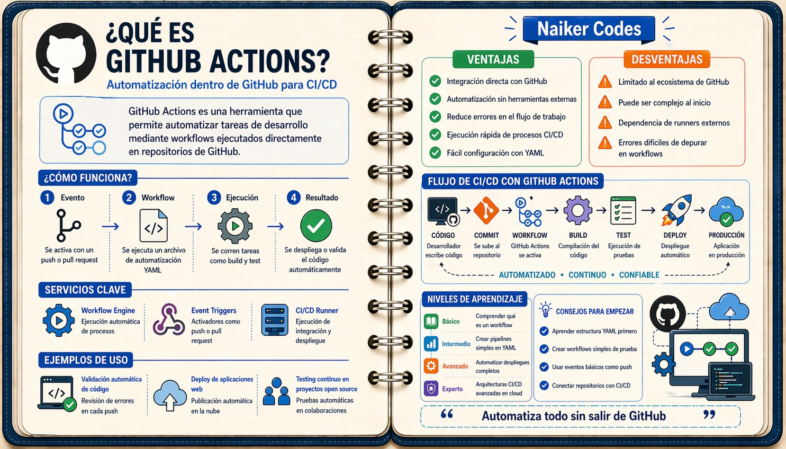

# Conceptos de GitHub Actions

## Vocabulario mínimo

- **Workflow:** automatización definida en un archivo YAML.
- **Evento:** hecho que inicia una ejecución, como un `push`.
- **Job:** conjunto de pasos que se ejecuta en un runner.
- **Step:** operación dentro de un job; los pasos se ejecutan en orden.
- **Runner:** máquina que ejecuta el job. Usaremos `ubuntu-latest`, alojada por GitHub.
- **Action:** componente reutilizable, como descargar el código o preparar Node.js.



## Cómo se relacionan

Un evento inicia un workflow. Este contiene jobs, y cada job contiene steps. Los jobs pueden ejecutarse en paralelo si no se define una dependencia; los pasos de un mismo job comparten su espacio de trabajo.

```yaml
jobs:
  verificar:
    runs-on: ubuntu-latest
    steps:
      - uses: actions/checkout@v4
      - name: Mostrar mensaje
        run: echo "Código descargado"
```

Este fragmento es solo la sección `jobs`, no un workflow completo. `verificar` es el identificador del job; `name` es el nombre visible de un paso. `checkout` descarga el repositorio: el runner no recibe automáticamente tus archivos.

Cada job alojado en GitHub empieza en un entorno nuevo. Un archivo creado en un job no aparece automáticamente en otro.

## Desafío

Abre `.github/workflows/deploy.yml` del proyecto e identifica un workflow, su evento, dos jobs, el runner y dos actions.

**Entrega:** una lista con los nombres reales y una frase que explique cada función.
