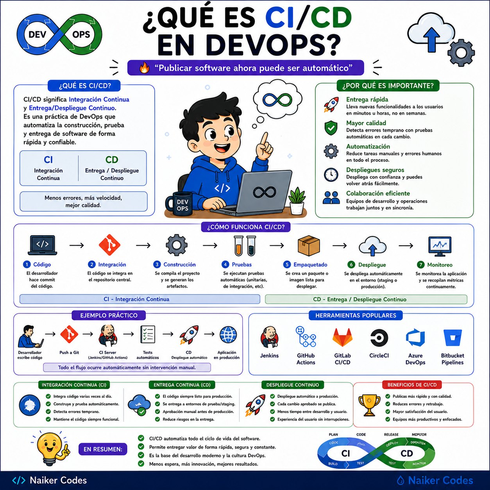
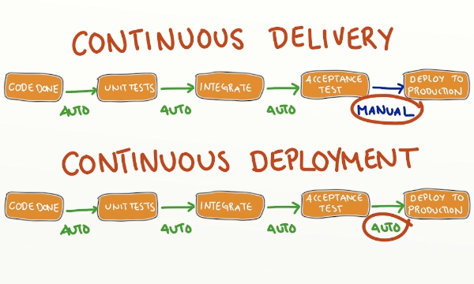

# Introducción a CI/CD



## El problema

Un cambio puede funcionar en tu equipo y fallar al integrarse: falta una dependencia, hay un error de tipos o el sitio no compila. Un **pipeline** ejecuta comprobaciones repetibles para detectar estos problemas.

- **Integración continua (continuous integration):** integrar cambios pequeños con frecuencia y validarlos automáticamente.
- **Entrega continua (continuous delivery):** mantener una versión validada y lista para publicar; la publicación puede requerir una decisión humana.
- **Despliegue continuo (continuous deployment):** publicar automáticamente cada cambio que supera las comprobaciones.



## Ejemplo del curso

En este sitio Docusaurus, un pull request puede ejecutar instalación, comprobación de tipos y compilación. Después de integrar el cambio en `main`, otro workflow publica el sitio en GitHub Pages.

Una ejecución verde confirma las comprobaciones programadas; no garantiza que todo el producto esté libre de errores.

## Proyecto para las prácticas

Usaremos el sitio Docusaurus del curso como proyecto base: [cloud-computing-course](https://github.com/JuanJoseMirandaM/cloud-computing-course). Así podemos practicar CI/CD sobre un sitio que ya funciona, sin desarrollar otra aplicación.

### Preparar tu copia

1. Abre el repositorio base y pulsa **Fork** para crear una copia en tu cuenta. Conserva el nombre `cloud-computing-course` y la rama principal `main`.
2. Clona **tu fork**, reemplazando `TU-USUARIO` por tu usuario de GitHub:

   ```bash
   git clone https://github.com/TU-USUARIO/cloud-computing-course.git
   cd cloud-computing-course
   ```

3. Necesitas Git, Node.js 22 y npm. Si tienes mise instalado, usa el archivo `mise.toml` incluido:

   ```bash
   mise trust
   mise install
   mise exec -- npm ci
   mise exec -- npm start
   ```

   Si ya tienes Node.js 22 activo, ejecuta directamente `npm ci` y `npm start`.

4. Abre la dirección que muestre la terminal y comprueba que el sitio carga.
5. En **tu fork → Actions**, habilita los workflows si GitHub lo solicita. Necesitas acceso a **Settings** para configurar secretos y Pages durante las prácticas.

Trabaja en ramas y abre los pull requests contra `main` de **tu propio fork**. Al crear un PR, comprueba el repositorio de destino: GitHub puede proponerte el repositorio original del curso.

El runner de GitHub tendrá su propia instalación de Node.js, configurada por el workflow; no usa automáticamente el Node.js de tu equipo.

Conserva `package.json` y `package-lock.json`. El proyecto ya incluye `typecheck` y `build`; añadiremos una prueba pequeña más adelante. Si tu copia conserva `.github/workflows/deploy.yml`, activa Pages al llegar al tema 8 o deshabilita temporalmente ese workflow desde Actions para evitar intentos prematuros de publicación.

## Desafío

1. Describe qué se comprobaría al proponer un cambio de documentación.
2. Indica qué ocurriría al integrarlo en `main`.
3. Explica dónde colocarías una aprobación humana si quisieras entrega continua.

**Entrega:** un párrafo con los tres pasos y la diferencia entre entrega y despliegue continuo.
